<div align="center">

# Практическое задание 9. Git

</div>

## Задания на оценку 3

### 1. Текущая ветка:
`git status`

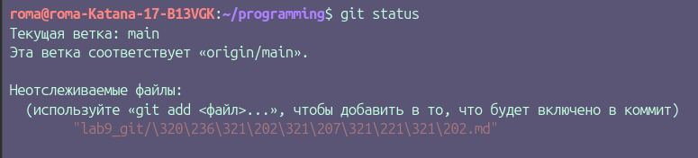

В текущий момент нахожусь в ветке **main**

### 2. Как выглядит `git log`

История коммитов репозитория от старых к новым

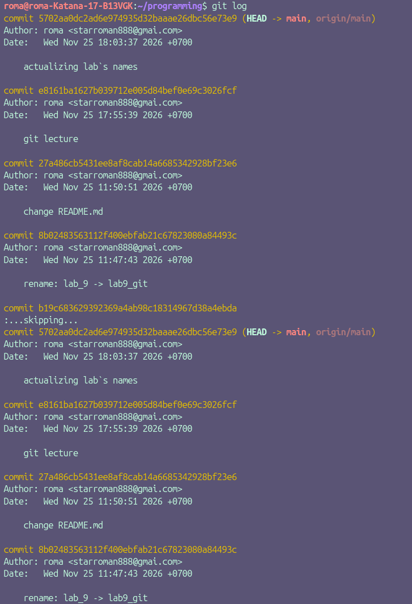

### 3. Создание файла sort.c с Quick sort внутри


```
void quick_sort(int *a, int left, int right) {
    if (left >= right) return;
    int pivot = a[(left + right) / 2];
    int i = left, j = right;
    while (i <= j) {
        while (a[i] < pivot) i++;
        while (a[j] > pivot) j--;
        if (i <= j) {
            int tmp = a[i]; a[i] = a[j]; a[j] = tmp;
            i++; j--;
        }
    }
    quick_sort(a, left, j);
    quick_sort(a, i, right);
}
```

### 4. `git status` после добавления файла

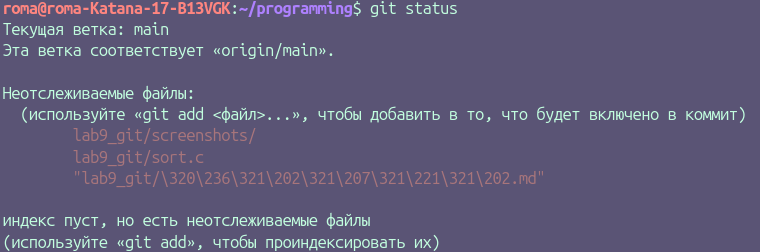

ветка всё также **main**, изменился пункт `Неотслеживаемые файлы:`

### 5. + 6. Добавил файл sort.c в stage (`git add`) + вывод (`git status`)

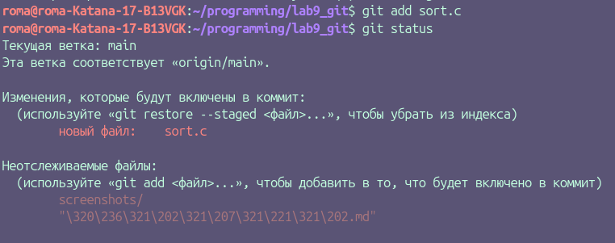

файл sort.c добавлен в `Изменения, которые будут включены в коммит`

### 7. + 8. Закоммитить файл в репозиторий + вывод (`git status`)

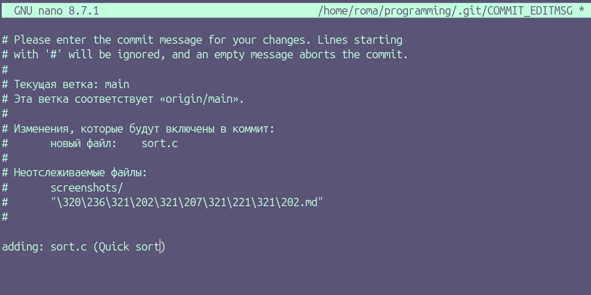

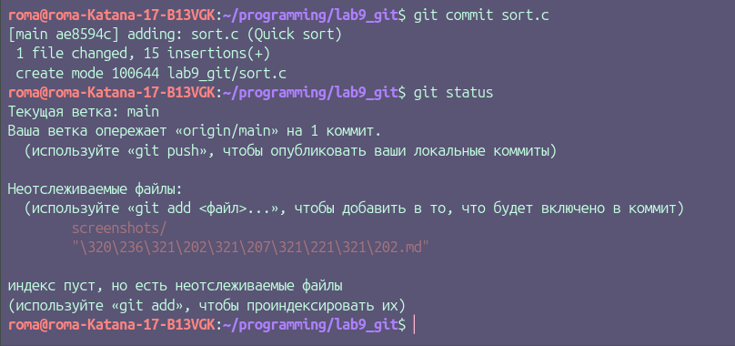

### 9. + 10. + 11. Добавление комментария в sort.c  + вывод (`git status`) + добавление (`git add`)

```
// квик сорт по схеме Хоара

void quick_sort(int *a, int left, int right) {
    if (left >= right) return;
    int pivot = a[(left + right) / 2];
    int i = left, j = right;
    while (i <= j) {
        while (a[i] < pivot) i++;
        while (a[j] > pivot) j--;
        if (i <= j) {
            int tmp = a[i]; a[i] = a[j]; a[j] = tmp;
            i++; j--;
        }
    }
    quick_sort(a, left, j);
    quick_sort(a, i, right);
}
```

`git status` + `git add sort.c`

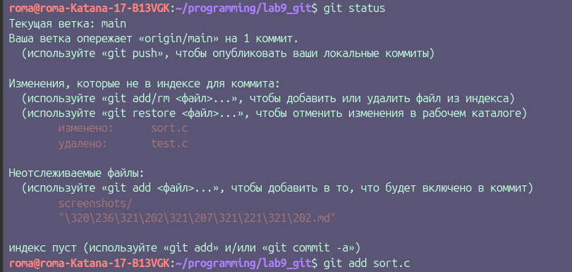

### 12. `git status`

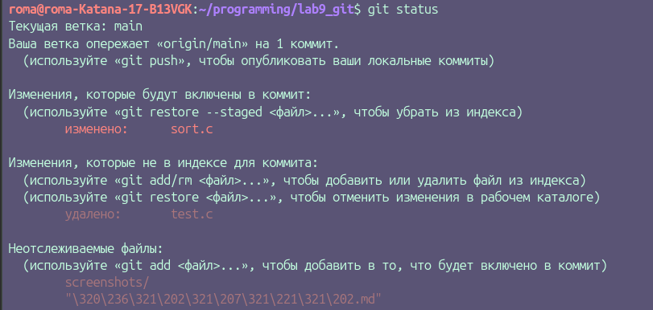

(удалил лишний файл test.c)

### 13. + 14. Изменение файла sort.c ещё раз + коммит (`git commit`)

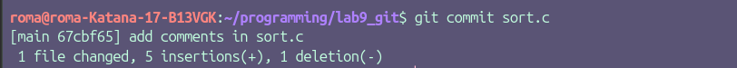

### 15. `git status` + `git log --online --graph --decorate`

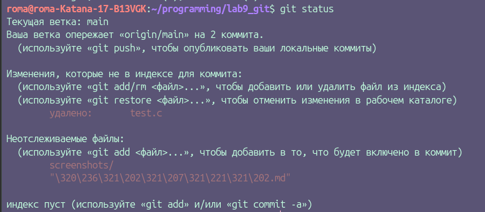

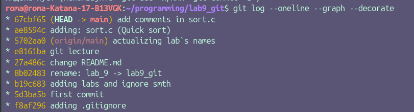

### 16. Добавление последних изменений(`git add .`) + коммит (`git commit`)

